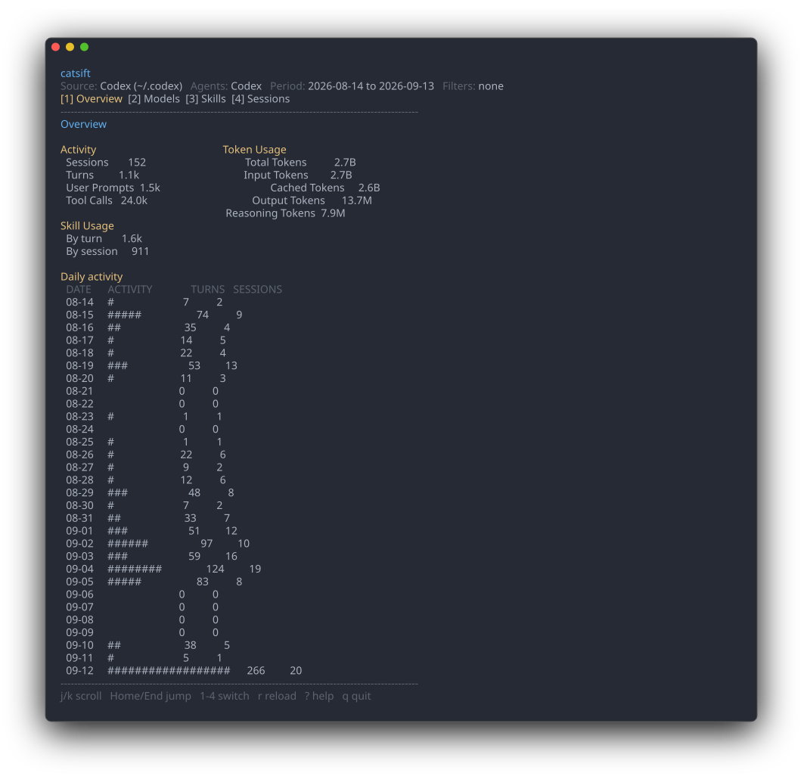

# CatSift: Sift through Coding Agent Traces

CatSift analyzes local coding-agent history and presents usage data by source,
model, skill, and session.

[日本語版](README.ja.md)

> [!NOTE]
> CatSift reads:
> - Codex local history
> - GitHub Copilot CLI local history
> - OpenCode local history
> - [ctx](https://github.com/ctxrs/ctx) event stream (experimental)

## Quick start

Try CatSift without installing it first:

```sh
npx catsift
```



## Installation

Install with npm:

```sh
npm install --global catsift
```

Or download from [GitHub Releases](https://github.com/xkumiyu/catsift/releases).

Or install from source:

```sh
go install github.com/xkumiyu/catsift/cmd/catsift@latest
```

To install the CatSift skill for AI agents:

```sh
npx skills add xkumiyu/catsift
```

## Usage

Launch interactive mode:

```sh
catsift
```

Explore local agent usage with the following views:

| View | Shows |
| --- | --- |
| Overview | Usage totals, recent activity, recent sessions, and top skills/models |
| Activity | Daily or monthly activity |
| Models | Token usage by provider and model, with related sessions |
| Skills | [Skill usage](#skill-usage-fields), evidence state, related sessions, and installed skills unobserved in selected history |
| Sessions | Session metadata and chronological turn details |

Filter usage by period or keywords and sort lists. Press `?` inside the TUI for details.

## Common options

These options apply to both [interactive mode](#usage) and [CLI mode](#cli-usage):

- `--source` selects one or more history sources: `codex`, `copilot`, `opencode`, or
  `ctx`. Separate sources with commas or repeat the option. If omitted,
  CatSift automatically reads available agent-specific histories. The `ctx`
  event stream is not auto-detected; select it explicitly.
- `--strict-input` exits non-zero when input records are skipped.

## Skill usage fields

Skill usage is categorized by activation mode and evidence state.

| Dimension | Field | Meaning |
| --- | --- | --- |
| Activation mode | `Explicit` | An explicit skill request or invocation was observed, such as `$skill-name` or a structured Skill call. |
| Activation mode | `Implicit` | Usage inferred from runtime access to a skill's `SKILL.md` or scripts without an explicit request. |
| Activation mode | `Unknown` | Skill evidence was found, but the history does not reveal whether activation was explicit or implicit. |
| Evidence state | `Confirmed` | The history contains direct evidence that the skill instructions or a skill item/tool was loaded or invoked. |
| Evidence state | `Inferred` | Usage inferred from runtime file or script access. |
| Evidence state | `Unconfirmed` | An explicit request was observed, but no confirming evidence was found. |

Activation mode and evidence state are independent. A single usage can have
evidence for more than one activation mode, so the mode counts do not always
add up to `Total`.

## CLI usage

Run a subcommand to execute CatSift in CLI mode.

| Command | Description |
| --- | --- |
| `catsift stats` | Show an overview of agent usage |
| `catsift activity` | Show daily activity |
| `catsift models` | Show model usage and details |
| `catsift tools` | Show tool usage by canonical name |
| `catsift skills` | Show skill usage and evidence state |
| `catsift sessions` | Show session usage and details |

Use a command's `detail` subcommand to view one model, skill, or session.

See each command's `--help` output for details.

### Optional: Session purpose classification

You can use Jev to classify session purposes.

- When configured, classification runs when you execute `catsift sessions` or
  launch the TUI with `catsift`.
- Session titles and user-authored messages are used for classification.
- Classifying 100 sessions costs about $0.01. Actual cost varies with message
  length.[^1]

[^1]: Estimated at $0.042 per 1 million input tokens.

#### Configuration

1. Run `catsift config init` to create the config file.
2. Open the config file and set `session_purpose.enabled` to `true`.
3. Set the `TYPESAFE_API_KEY` environment variable.

### Skill usage

Use `--group-by` to aggregate by turn or session, and `--strict` to include only confirmed usage.

```sh
catsift skills --group-by session --strict
catsift skills detail review
```

#### Unused skills

Use the TUI Skills view or `catsift skills --unused` to find installed skills
unobserved in the selected history.

```sh
catsift skills --unused
```

Rows are identified by canonical skill name plus absolute path; same-name skills at different paths stay separate.
A name is considered used if any agent in the selected history used it.

`--root` is a scan scope: only `.agents/skills/`, `.codex/skills/`, and plugin cache layouts under it are recognized.
Flat `SKILL.md` directories are ignored.

## Cache

Parsed results are cached in the OS-standard user cache directory to speed up
subsequent runs.

## Data handling

CatSift reads selected history from Codex, GitHub Copilot CLI, OpenCode, or ctx.
All inputs are read-only. History remains local unless optional purpose
classification is enabled, in which case session titles and user-authored
messages are sent to TypeSafe System One.
The TUI and `skills --unused` also read the installed skill inventory. The TUI and reports
exclude prompt text, command text, Tool arguments, Skill bodies, provider
payloads, and other raw event details.
